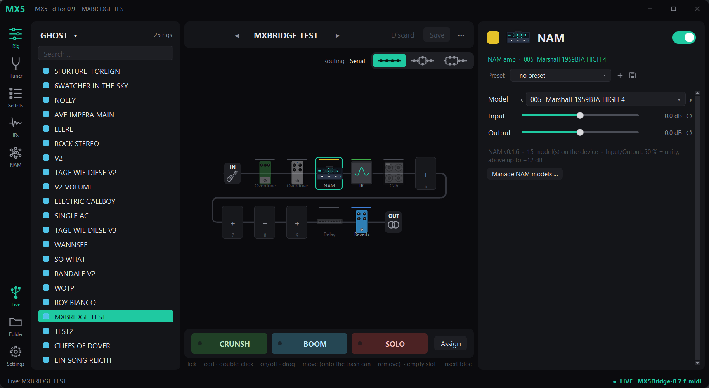

# MX5 Bridge + MX-Edit (with NAM-Mod Support)

**Unofficial** tooling for the **HeadRush MX5** guitar processor – and, as a beta, the
**HeadRush Pedalboard** ([details](#headrush-pedalboard-beta)):

- **MX5 Bridge**: a small add-on to the stock MX5 firmware 2.7. It gives the device's internal
  parameter tree, its rig database and its files to a computer over **USB-MIDI (SysEx)**.
- **MX-Edit**: a desktop editor for Windows that uses the bridge. It works like the
  HeadRush web editor, but **live**: every change is heard on the device right away, and changes
  made on the device show up in the editor.



> **Not affiliated with HeadRush or inMusic.** HeadRush is a trademark of inMusic Brands.
> Installing modified firmware is **at your own risk**. Read the [installation](#installation)
> steps below first, especially the part about getting back to the stock firmware.

## Installation

You need a HeadRush **MX5 on firmware 2.7** (Pedalboard: see
[below](#headrush-pedalboard-beta)), its power supply, a USB cable and a Windows 10/11 PC. It takes about 15 minutes. There is also a [video guide on YouTube](https://youtu.be/6ivzolrPEZA?si=BKzsChsaO2G2xgYX).
More details and troubleshooting: [INSTALL.md](INSTALL.md).

**0. Back up your rigs.** On the MX5, enable *USB transfer mode* (Global Settings) and copy the
`Rigs`, `Setlists`, `Blocks` and `Impulse Responses` folders to your PC.

**1. Download** `MX5Bridge_0.7_Patcher.exe` and `MX-Edit_0.9.exe` from the
[latest release](../../releases/latest). Nothing has to be installed, Python is not needed.
Windows SmartScreen may warn about an unknown publisher: *More info › Run anyway*.

**2. Build the firmware.** Put `MX5Bridge_0.7_Patcher.exe` into an empty folder and start it.

- **Bridge only:** click **Build updater**. The patcher downloads the official HeadRush updater
  and adds the bridge (1–2 minutes).
- **Bridge + NAM mod:** tick **Also install the NAM mod**, then click **Build updater**.
  A second window opens – the NAM mod's own installer:
  1. choose **MX5** and the number of instances, click **Install NAM Mod**,
  2. **then just wait.** ⚠️ **Do not click "Open"** in the NAM installer and do not run the
     `… (NAM mod).exe` it creates – that one has **no bridge**.
     The patcher **closes the NAM installer by itself** and adds the bridge on top.

When the patcher says **Updater ready**, you have `MX5Bridge_0.7_Updater` (or
`MX5Bridge_0.7_NAM_Updater`). **This is the only updater you install.**

**3. Flash it.**

1. Connect the MX5 to its **power supply** and via **USB** to the PC.
2. On the MX5: **Global Settings › ⋯ (more) › Firmware Update**.
3. In the patcher, click **Start firmware updater**. The window title must say
   *"MX5Bridge 0.7"*. Click **Install MX5Bridge 0.7** (or **… + NAM**) and wait.
   **Do not disconnect** the MX5 until it has restarted.

Your rigs, setlists, presets and IRs stay on the device.

**4. Start the editor.** Double-click `MX-Edit_0.9.exe`. About 10 seconds after the MX5 has
started, the editor connects by itself. With NAM, manage your `.nam` models with the **NAM**
button in the editor's left bar.

> **Flashed the NAM installer's updater by mistake?** No harm done – NAM is on the device, but
> the bridge is not. Just flash `MX5Bridge_0.7_NAM_Updater` afterwards (step 3).
>
> **Already have an updater from the NAM installer**
> (`HeadRush MX5 Firmware Updater (NAM mod).exe`)? Tick both boxes in the patcher
> (*Use a firmware file I already have* + *Also install the NAM mod*) and choose that file.
>
> **Back to stock:** run the official HeadRush MX5 2.7 updater the same way. If the device no
> longer starts, hold **footswitches 1 + 2** while switching it on (recovery mode).
> ⚠️ Footswitches **2 + 3** at power-on is a **factory reset** and erases your rigs.

### HeadRush Pedalboard (beta)

The Pedalboard is supported **as a beta**. Testers have confirmed that the bridge runs on it, and
MX-Edit was adapted from their diagnosis logs, but I don't own a Pedalboard, so the editor has not
been run on a real one by me. Please [report](../../issues) what works and what doesn't.

- **Downloads:** take `MX5Bridge_0.7_Patcher.exe` and `MX-Edit_0.9.6-beta…exe` from the newest
  **pre-release** on the [releases page](../../releases) (the *latest* release is MX5 only).
- **Patcher:** under **Device**, choose **Pedalboard (beta)**. It downloads the official
  *HeadRush Pedalboard 2.7* updater and creates `HeadRush_Bridge_0.7_Pedalboard_Updater`. The
  button in the firmware updater is called **Install HeadRush Bridge 0.7**. Flash it like in step 3
  (on the Pedalboard: *Global Settings › ⋯ › Firmware Update*).
- **Editor:** connects to the port *Headrush Pedalboard* and shows **PEDALBOARD BETA** at the bottom
  right. It works on **All Rigs** – Pedalboard setlists hold *songs*, which are not supported yet,
  so the setlist manager, *New* rig and *Restore everything* are switched off. The 8 assignable
  footswitches are shown in two rows where they sit on the device.
- **NAM mod:** not tested together with the bridge on the Pedalboard yet.
- **Back to stock:** run the official HeadRush Pedalboard 2.7 updater. If the device no longer
  starts, hold **footswitches 1 + 8** while switching it on (recovery mode). Don't try other
  footswitch combinations at power-on – one of them may be a factory reset.
- The **Gigboard** is not supported (no diagnosis log so far). Owners can help with the tools in
  the [testing repository](https://github.com/TicT4x/MX-Edit-Testing).

The editor and the patcher are also available as Python source (`MX-Edit_0.9.zip`,
`MX5Bridge_0.7_Patcher.zip`), see [INSTALL.md](INSTALL.md#run-from-source-optional).

## What the editor can do

- **Signal chain**: add, remove and move blocks with drag & drop. Pick the routing
  (serial / parallel), double amps, cabs and IRs, and switch blocks on/off. Model picker with
  an icon for every amp, cab and effect.
- **All parameters** of every block, with the labels the device uses for each amp model.
  Load **block presets**, and save your own or overwrite them.
- **Rigs**: All Rigs and setlists in device order. Load, save, *save as new*, rename, colour,
  program numbers, delete. There is also a **setlist manager** (drag & drop, banks of three,
  numbering).
- **Footswitches, scenes and pedals**: scene/toggle mode, labels, colours, which blocks a scene
  switches and which preset it loads, toggle assignments, expression pedal targets and ranges,
  and rig tempo.
- **Impulse responses**: upload, rename, delete and organise IR files, and audition them while
  browsing.
- **Looper**: record/overdub, start/stop, peel, clear, reverse, half/double speed and length,
  loop level, feedback, pre/post position and the footswitch layout, with a live position ring.
- **Tuner** and **input/output level meters**.
- **Backup / restore** of everything (rigs, setlists, block presets) as the same `.rig`,
  `.setlist` and `.block` files the MX5 writes in USB transfer mode.
- **Offline mode**: edit `.rig` files from a backup without the device.
- **Optional NAM support**: works together with the
  [HeadRush NAM mod by lolgab](https://github.com/lolgab/headrush-nam-mod). It manages NAM
  models and shows NAM blocks as amps. Turning NAM off and on needs a restart of the device app.
- Reconnects on its own when the device restarts or the cable is pulled.

## What the bridge adds to the device

- A USB-MIDI port **"HeadRush MX5"** next to the stock USB audio.
- SysEx commands to read and write any property (`/Engine/Patch/...`), run small scripts in the
  device's QML engine, and query or modify the rig database (SQLite).
- **Safety**: the bridge backs up the rig database automatically before the first write after
  each boot. It has a crash guard: after three app crashes in a row it restores that backup (with
  NAM: it switches NAM off first). The stock rig database is never replaced wholesale.
- File access for impulse responses and NAM models.

Developers: the protocol is described in [docs/PROTOCOL.md](docs/PROTOCOL.md), and
[`editor/bridge.py`](editor/bridge.py) is a small Python client for it.

## How the firmware is distributed

This project **does not ship any HeadRush firmware**. The **patcher** works like the NAM mod
installer:

1. It downloads the **official** HeadRush MX5 (or Pedalboard) 2.7 updater from inMusic's server
   (or uses a copy you already have).
2. It adds the bridge files to that firmware **on your computer**.
3. It writes a ready-to-run updater folder that uses HeadRush's own `FirmwareUpdater.exe`.

The patcher is a single Windows program with a window (`MX5Bridge_0.7_Patcher.exe`). It needs
neither Python nor Linux/WSL. It can also run the NAM mod's own installer for you, so you get both
(see [Installation](#installation)).

## Requirements

| | |
|---|---|
| Device | HeadRush **MX5** with firmware **2.7**; HeadRush **Pedalboard** 2.7 as a beta (Gigboard: not supported) |
| Computer | Windows 10/11. The editor uses Windows-only window code. The patcher's source version also runs on Linux/macOS (Python 3 only) |
| Python | not needed for the `.exe` files. For the source versions: 3.9 or newer, editor with `mido`, `python-rtmidi`, `pillow` |

## Repository layout

```
editor/            MX-Edit (Python/tkinter) + bridge.py client
editor/werkzeuge/  test program, regression test, catalog builder (developer tools)
firmware/          bridge firmware: patcher, device files (mod/), build scripts
docs/PROTOCOL.md   SysEx protocol and useful device property paths
```

Source comments and developer tool output are mostly in German. The editor UI, the patcher and
the docs are in English.

## Status

The project was developed and tested on one MX5 against firmware 2.7, with an automated
regression test (`editor/werkzeuge/regressionstest.py`, 30 steps) that runs against the real
device. It is a hobby project: expect rough edges, and keep a backup of your rigs
(*⋯ › Back up everything* in the editor).

- Windows only (10/11) for now
- Made for the MX5. **HeadRush Pedalboard: beta** (patcher and MX-Edit 0.9.6 beta) – the bridge
  runs on it (confirmed by testers), the editor was built from their diagnosis logs and has not been
  run by me on a real Pedalboard. It works on *All Rigs* there (Pedalboard setlists hold songs, which
  it does not support yet); chain, parameters, block presets, saving, the 8 footswitches, pedals,
  tuner, looper and IRs should work. See [HeadRush Pedalboard (beta)](#headrush-pedalboard-beta) and
  please [report](../../issues) what works.
- Gigboard: not supported yet (no diagnosis log so far).

## Disclaimer

This only works with custom firmware. I wouldn't advise installing random stuff from the internet on the MX5, because you can brick those devices with the wrong firmware. That's also why I don't ship any HeadRush firmware myself, the patcher builds it on your PC from the official file, and the whole source code is on GitHub so everyone can check what it does. AI can be of help detecting shitty stuff, but isnt a guarantee.****

## Credits & licences

- MX5 Bridge and MX-Edit: [MIT licence](LICENSE).
- [`firmware/bin/sqlite3`](firmware/bin): a static ARM build of [SQLite](https://sqlite.org)
  (public domain), built with `firmware/tools/build-sqlite3.sh`.
- NAM support uses the [HeadRush NAM mod](https://github.com/lolgab/headrush-nam-mod) by lolgab
  (GPLv3). It is **not included**: the NAM mod's own installer or `firmware/tools/nam-mod.sh`
  fetches it from its repository.
- The model icons are original flat drawings, not HeadRush artwork.
